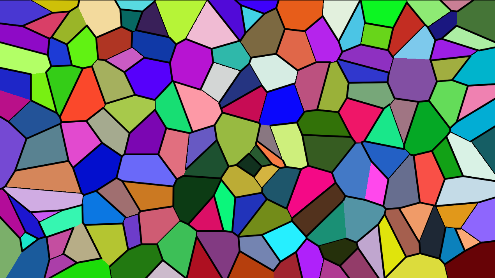
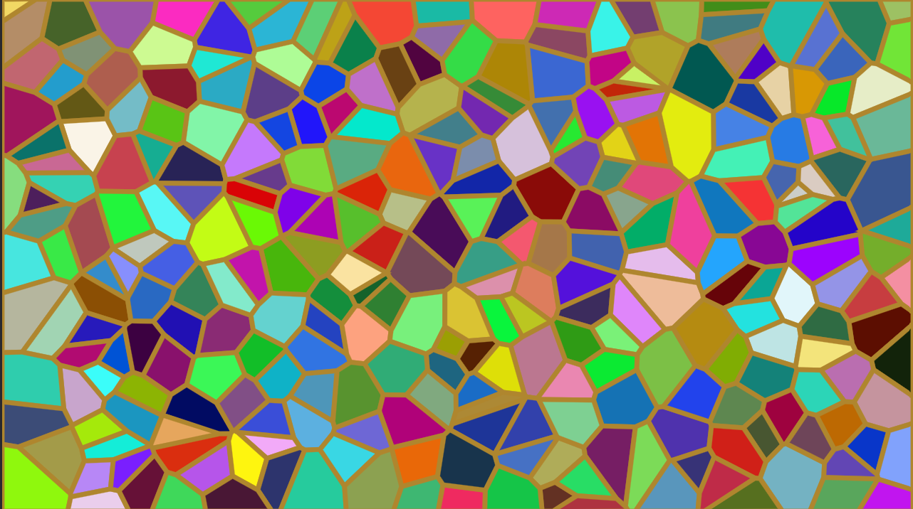
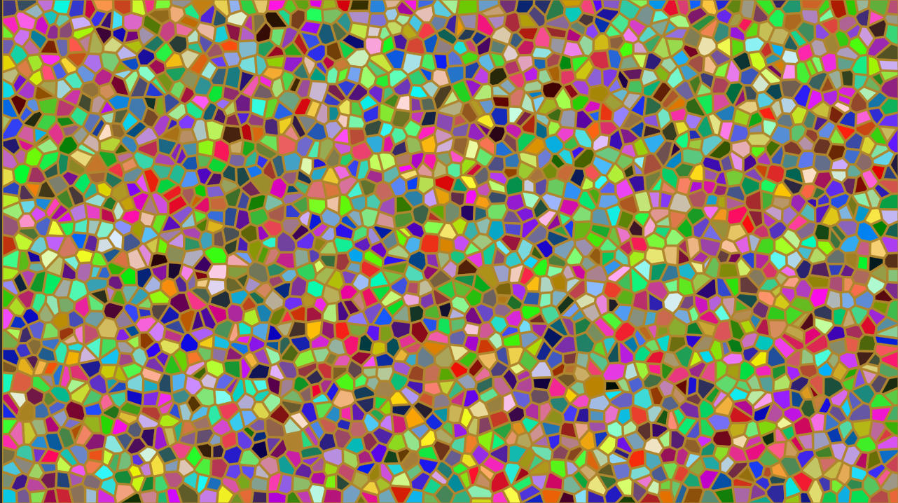
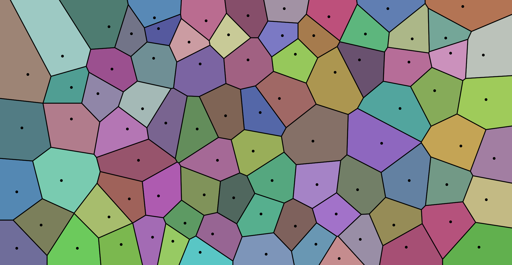

# Voronoi-Map-generator
this is a basic voronoi map generator, built in __Godot 4.5.1(gdscript)__

### It has used *__Sutherland-Hodgeman polygon clipping algorithm__*

__Time Complexity__: *O($n^2$)*

# Some generated Images:
1. 

2. 

3. 

4. 

